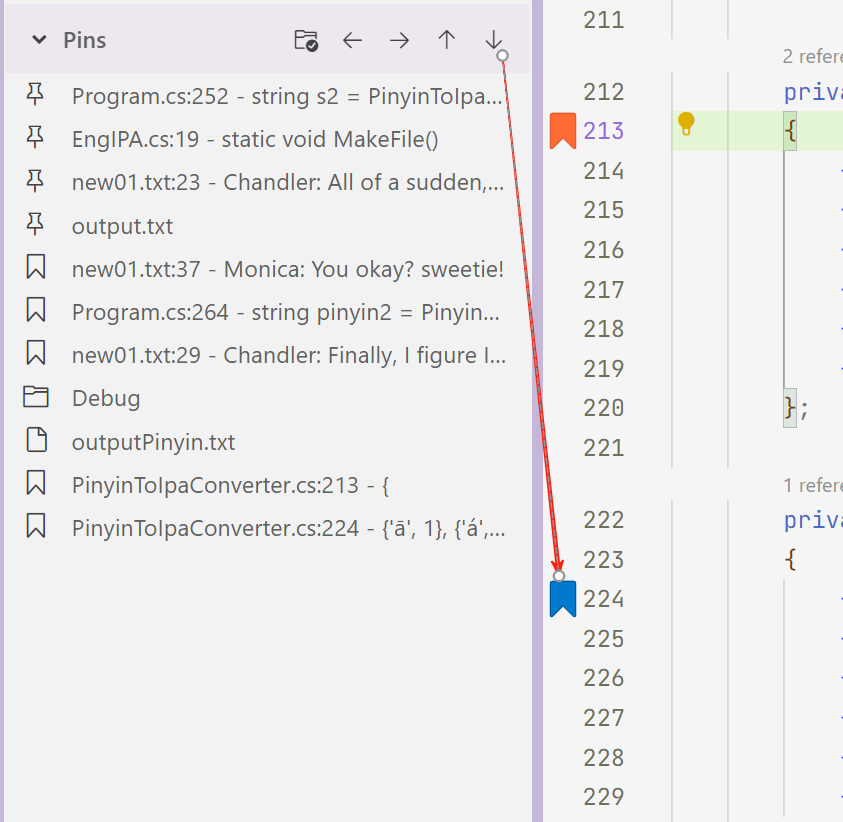

# PinInExplorer

[**English**](#english) · [简体中文](#简体中文)

---

## English

Pin files, folders and code bookmarks right into the Explorer's **Pins** view for instant access.

> Works in **VS Code / TRAE / CURSOR**.

### Features

#### Pin / Unpin

Right-click a file or folder in the Explorer and select **Toggle Pin** to pin or unpin it.

#### Pins View Actions

- 📂 **Open** – open the pinned file or folder directly
- ⬆️ **Move Up** – move the selected item up one position
- ⬇️ **Move Down** – move the selected item down one position
- 📌 **Pin to Top / Remove from Top** – keep important items at the top of the list

#### Code Bookmarks

- Add a bookmark by right-clicking a line in the editor and selecting **Toggle Pin** (Toggle Bookmark)
- Bookmarks are shown in the Pins view as `file:line - code content`
- Click a bookmark to jump to the exact code position
- Supports pin-to-top, removal, and automatic cleanup of bookmarks whose files no longer exist

#### Folder Focus

- When the last file in a folder is deleted and the folder becomes empty, the Explorer focus switches to that folder automatically
- Enable/disable this behavior via the folder icon in the Pins view title bar

### Development & Release

See [docs/Development.md](docs/Development.md) for build, packaging and publishing instructions.

### License

MIT © tony.tian · https://github.com/tony-long-xi/PinInExplorer

---

## 简体中文

将常用文件、文件夹和代码书签固定到资源管理器中的 **Pins** 视图，实现快速访问。

> 适用于 **VS Code / TRAE / CURSOR**。

### 主要功能

#### 固定 / 取消固定

在资源管理器中右键文件或文件夹，选择 **Toggle Pin** 即可固定或取消固定。

#### Pins 视图操作

- 📂 **打开** – 直接打开固定的文件或文件夹
- ⬆️ **上移** – 将选中的条目向上移动一位
- ⬇️ **下移** – 将选中的条目向下移动一位
- 📌 **置顶 / 取消置顶** – 将重要条目固定在列表顶部

#### 代码书签

- 在编辑器中右键某一行，选择 **Toggle Pin**（Toggle Bookmark）即可添加书签
- 书签以 `文件名:行号 - 代码内容` 形式显示在 Pins 视图中
- 点击书签可跳转到对应的代码位置
- 支持置顶、移除，并自动清理已删除文件的书签

#### 文件夹焦点

- 删除文件夹内最后一个文件、文件夹变为空时，自动将资源管理器焦点切换到该文件夹
- 通过 Pins 视图标题栏的文件夹图标开启/关闭此功能

### 开发与发布

编译、打包、发布请参考 [docs/Development.md](docs/Development.md)。

### 许可证

MIT © tony.tian · https://github.com/tony-long-xi/PinInExplorer
